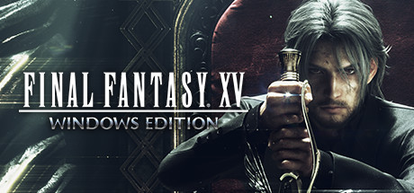

**Final Fantasy XV Windows Edition by Square Enix (2018) is the complete PC version including all DLC chapters.**

---

## 📖 About

Final Fantasy XV Windows Edition by Square Enix (2018) is the complete PC version including all DLC chapters. You travel the open world of Eos with Noctis and his three friends in a road-trip RPG. Royal Edition content and Chapter 14 expansion flesh out the controversial original ending.

## ⚠️ Problems Without Trainer

| Problem | Status |
|---------|--------|
| Lategame dungeon bosses at level 99 require optimal accessory builds not telegraphed | ✅ Solved |
| Menace dungeons with no save points require multi-hour no-damage consistency | ✅ Solved |
| Cooking ingredients for best stat boosts locked behind rare fishing and hunting | ✅ Solved |
| Regalia Type-F requires precise flight controls in optional high-level areas | ✅ Solved |
| Episode DLC collectibles locked behind completing multiple optional side events | ✅ Solved |

## ✅ Solution

The **Final Fantasy XV Windows Edition Trainer** solves all these issues, giving you complete control so you can focus on enjoying the game.

## 🎯 Features

- Unlimited Resources / Currency
- God Mode / Invincibility
- Instant Skill & Ability Cooldown
- One-Hit Kill
- Freeze Timers
- Unlock All Items & Achievements
- Custom Speed Multiplier
- Infinite Stamina / Energy

## 🚀 Quick Start

1. **Disable Windows Defender** temporarily (trainer may trigger false positive)
2. Get the trainer from the button above
3. Launch Final Fantasy XV Windows Edition
4. Run the trainer as Administrator
5. Use the hotkeys to activate cheats in-game

## 💎 Free vs Pro

| Feature | Free | Pro |
|---------|------|-----|
| God Mode | ✅ | ✅ |
| Unlimited Resources | ✅ | ✅ |
| Advanced Cheats | ❌ | ✅ |
| Auto-Updates | ❌ | ✅ |
| Priority Support | ❌ | ✅ |

## 💻 Requirements

- Windows 10 / 11 (64-bit)
- Final Fantasy XV Windows Edition (any version)
- .NET Framework 4.8+
- DirectX 11+

## 🍎 macOS

## ⚖️ Legal

Educational and single-player use only.

---

